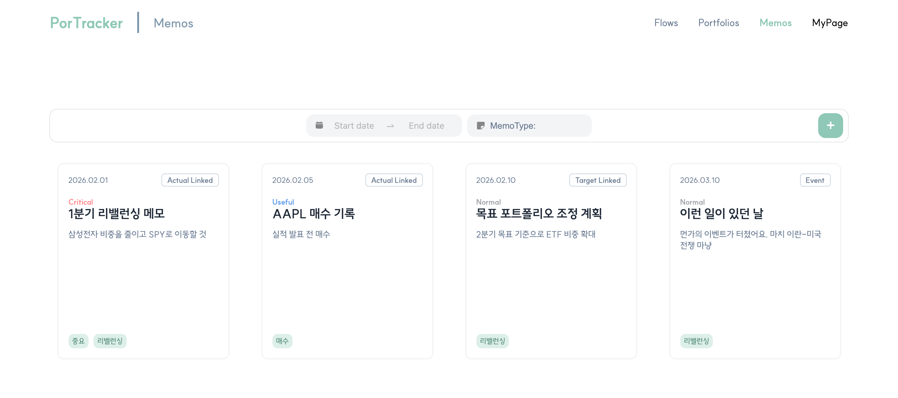
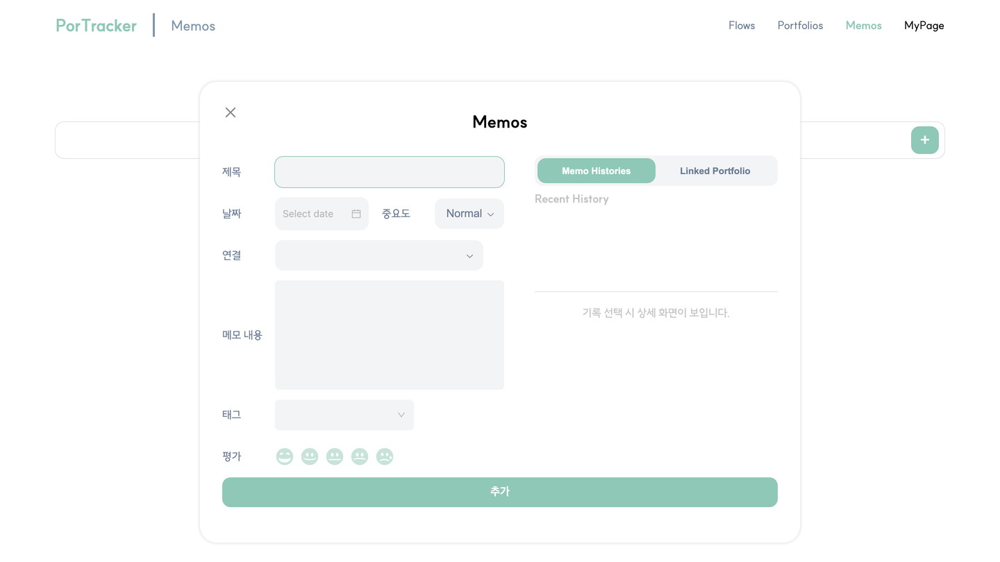
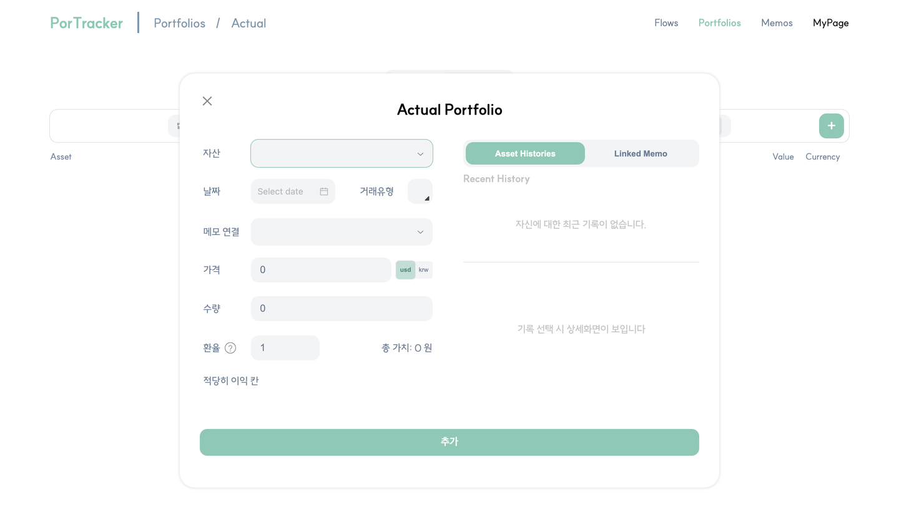

# PorTracker

포트폴리오의 **실제 거래 기록**과 **목표 비율**, 그리고 그때의 **판단 메모**를 함께 남기고 돌아보는 투자 기록 서비스의 프론트엔드입니다.

- **Memos**: 투자 메모를 중요도·태그·연결된 자산과 함께 남깁니다.
- **Portfolios**: 실제 거래 기록(Actual)과 목표 포트폴리오(Target)를 관리하고, 메모와 서로 연결합니다.
- **Flows** _(개발 중)_: 자산 흐름을 차트로 보고, 실제와 목표를 비교합니다.

## 화면

### Memos — 목록



메모를 카드로 모아 봅니다. 위쪽 필터로 기간과 메모 유형을 골라 좁힙니다.

### Memos — 작성·수정



제목·날짜·중요도·연결 대상·내용·태그·평가를 한 모달에서 적습니다. 오른쪽에서 같은 자산의 지난 메모(Memo Histories)와 연결된 포트폴리오(Linked Portfolio)를 같이 보며 작성합니다.

### Portfolios — 실제 거래 입력



자산·날짜·거래 유형·가격·수량·환율을 적으면 총 가치를 바로 셈해 보여 줍니다. 거래마다 메모를 연결할 수 있고, 오른쪽에서 같은 자산의 최근 거래(Asset Histories)와 연결된 메모(Linked Memo)를 봅니다.

## 기술 스택

| 영역 | 사용 |
|---|---|
| 프레임워크 | Next.js 16 (App Router, RSC · Server Actions), React 19 |
| 모노레포 | Nx, pnpm |
| 스타일 | StyleX, CSS Modules(radix 상태 선택자) |
| UI | Radix UI, Ant Design(일부 입력 컴포넌트) |
| 상태 · 데이터 | Jotai, TanStack Query, Zod |
| API | openapi-fetch + BE OpenAPI 스키마로 생성한 타입 |
| 차트 | ECharts |
| 목업 · 문서 | MSW, Storybook |
| 인증 · 관측 | Supabase Auth, Sentry |

## 구조

```
apps/core
├── app/                   # 라우트. (main) 화면 · (auth) 로그인
├── components/
│   ├── shared/            # ATOMS · MOLECULES — 도메인을 모르는 공용 컴포넌트
│   └── <도메인>/ORGANISMS/ # 데이터를 받는 바깥(RSC) + 그리는 안(View, client)
├── services/              # 화면이 부르는 진입점. 응답을 Zod로 검증해 Response<T>로 돌려줌
├── server/
│   ├── aggregates/        # 여러 repository를 묶어 화면 꼴로 변환
│   └── repositories/      # BE 엔드포인트 하나 = 함수 하나 (openapi-fetch)
├── schemas/               # domains(원천 꼴) → features(화면 꼴)
├── mocks/                 # repository가 부르는 BE 경로를 MSW로 그대로 흉내
└── tokens · styles        # 색 · 폰트 토큰, 공용 StyleX 스타일
```

데이터는 `page → services → aggregates → repositories → BE` 한 방향으로만 흐릅니다.

## 실행

```bash
pnpm install
pnpm dev          # nx serve core
pnpm storybook    # 컴포넌트 문서
pnpm test         # jest
pnpm gen:api-local  # 로컬 BE(8080)의 OpenAPI로 API 타입 재생성
```

---

## 개발 유의 사항

> 디렉토리 구조 및 import 경로 처리에 대해 - **Mocking**

- mocks 폴더 내에서 **서로를 참조**할 때는 **상대 경로**만 사용 및 **index.ts(배럴 파일) 참조 금지**

- **services** 폴더 내의 **client, server** 구조와 **mocks/services** 폴더 내 구조를 **동일하게** 맞춘다.

  - 디렉토리 구조만이 아니라, 함수에 대해서도 같도록 **mocks/services 정의 시 services에서의 interface를 사용한다**.

- **services**에서 새로운 queries 및 actions 파일 **생성 시, 배럴 파일에서 export**

- **mocks/services**에서 새로운 queries 및 actions 파일 생성 시, **배럴 파일에서 mockTotalServices에 추가 + named export에 관련 함수들 추가**

---

> #### Mocking 관리 상세 정보

- Storybook에서의 alias를 활용해 mocking 시스템이 동작
- rsc관련 parameter에 따라 msw 사용 여부 결정됨.

  - 이는 storybook rsc관련 플러그인이 msw와 함께 동작할 때 에러가 나는 이슈가 있기 때문.

  - 시스템 제작하여 위 이슈를 해결.
